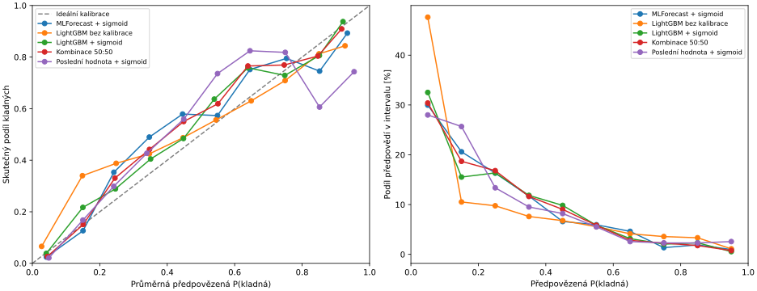
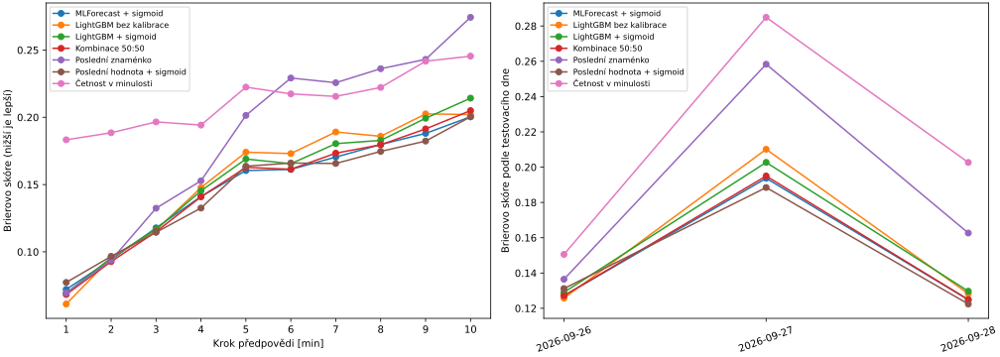

# MLForecast, klasifikátor LightGBM a kombinace: výsledky

[Spustit stejné vyhodnocení v Google Colabu](https://colab.research.google.com/github/000307/Odchylky/blob/main/predikce_nixtla_znamenka_colab.ipynb)

Nejlepší Brierovo skóre v tomto běhu dosáhl **MLForecast se sigmoidní kalibrací**. Nejnižší celkové ECE měl **kalibrovaný klasifikátor LightGBM**. Pevná kombinace 50:50 nejlepší Brier jednotlivé složky nepřekonala.

Vyhodnocení zahrnuje **288 čtvrthodin z 26.–28. září 2026**, tedy 2 880 budoucích minut. Jedna skutečná hodnota byla přesně nulová; Brier, log-loss a ECE proto používají **2 879 nenulových případů**. Z celé šestidenní řady bylo dostupných 574 úplných čtvrthodin; tři neúplné byly vynechány.

## Souhrn

| Metoda | Brier ↓ | Log-loss ↓ | ECE ↓ | Správná znaménka včetně nuly |
| --- | ---: | ---: | ---: | ---: |
| MLForecast + sigmoid | 0,14854 | 0,44386 | 0,06316 | 76,77 % |
| LightGBM + sigmoid | 0,15382 | 0,46146 | 0,03920 | 77,15 % |
| Kombinace 50:50 | 0,14904 | 0,44680 | 0,04895 | 76,88 % |
| LightGBM bez kalibrace | 0,15472 | 0,46948 | 0,06558 | 77,12 % |
| Poslední znaménko | 0,18583 | 5,13463 | 0,18583 | 81,39 % |
| Četnost v minulosti | 0,21272 | 0,62194 | 0,07971 | 71,08 % |

ECE používá deset pevných pravděpodobnostních intervalů; je závislé na jejich volbě a nevyjadřuje celou kvalitu předpovědí. Počty a průměrné pravděpodobnosti jednotlivých intervalů jsou v [kalibrační tabulce](vysledky_nixtla/kalibrace.csv). Pravděpodobnosti 0/1 u zachování posledního znaménka jsou deterministická reference.

## Co přinesla kalibrace a kombinace

- U klasifikátoru klesl Brier z 0,15472 na 0,15382 a celkové ECE z 0,06558 na 0,03920.
- Kombinace má Brier 0,14904 proti 0,14854 u MLForecast; rozdíl je malý a tento běh nedokazuje dlouhodobou převahu.
- Celkový skutečný podíl kladných minut činil 28,90 %. Průměrná P(kladná) byla 25,09 % u MLForecast, 25,46 % u kalibrovaného klasifikátoru a 25,28 % u kombinace. Všechny tři varianty tedy v celku podhodnocovaly četnost kladných hodnot.
- Zachování posledního znaménka má stále vyšší znaménkovou správnost; nové modely jsou v tomto srovnání lepší v pravděpodobnostním Brierově skóre.

## Rozdíly mezi dny

| Den | MLForecast Brier | LightGBM kalibrovaný Brier | Kombinace Brier | LightGBM kalibrovaný ECE |
| --- | ---: | ---: | ---: | ---: |
| 26. 09. 2026 | 0,12707 | 0,12906 | 0,12717 | 0,05390 |
| 27. 09. 2026 | 0,19368 | 0,20269 | 0,19499 | 0,07347 |
| 28. 09. 2026 | 0,12485 | 0,12968 | 0,12493 | 0,06985 |

Celkové ECE může zakrýt nestabilitu po dnech. Kalibrace klasifikátoru v souhrnu pomohla, ale Brier se proti jeho původním pravděpodobnostem nezlepšil každý testovací den.

## Oddělení dat a reprodukovatelnost

Pro každý testovací den se základní modely učí pouze z dnů před kalibračním dnem. Poslední předchozí dostupný den se použije jen k logistické kalibraci. Základní model se pak na tomto dni znovu nepřeučuje. Kombinace má předem pevné váhy 50:50. Parametry modelů ani kalibrátorů nebyly vybrány podle tohoto testovacího běhu.

| Testovací den | Počet čtvrthodin pro základní učení | Kalibrační den | Kalibračních čtvrthodin | Testovacích čtvrthodin |
| --- | ---: | --- | ---: | ---: |
| 26. 09. 2026 | 190 | 25. 09. 2026 | 96 | 96 |
| 27. 09. 2026 | 286 | 26. 09. 2026 | 96 | 96 |
| 28. 09. 2026 | 382 | 27. 09. 2026 | 96 | 96 |

Výchozí seed je `20261102`; ověřené verze jsou MLForecast `1.1.0` a LightGBM `4.7.0`. Podrobnosti a příkazy jsou v [návodu](NIXTLA_ZNAMENKA.md), verze dalších knihoven v [JSON](vysledky_nixtla/verze_knihoven.json).

## Vztah k předchozímu bayesovskému modelu

Dřívější Bayes AR(5) měl na stejných testovacích minutách Brier přibližně **0,1351**, tedy nižší než nové Nixtla varianty. Používal však jiný trénovací postup: všechny minulé dny byly použity pro bayesovský odhad parametrů a nevyhrazoval se samostatný kalibrační den. Tento údaj je kontext z předchozího experimentu, nikoli další řádek aktuálního běhu.

## Omezení závěrů

Jde o retrospektivní srovnání. Tyto tři testovací dny byly prohlíženy už při předchozích experimentech; pro konečné potvrzení vybrané varianty je potřeba nová, dosud nepoužitá historie. Jednotlivé minuty uvnitř stejné čtvrthodiny nejsou nezávislé vzorky. Z těchto tří dnů nelze potvrdit statistickou ani dlouhodobou převahu modelu.

V repozitáři jsou agregované výsledky; vstupní měření ani jednotlivé minutové skutečnosti nejsou součástí této sady výsledků.
